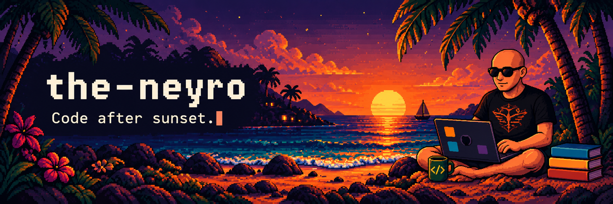
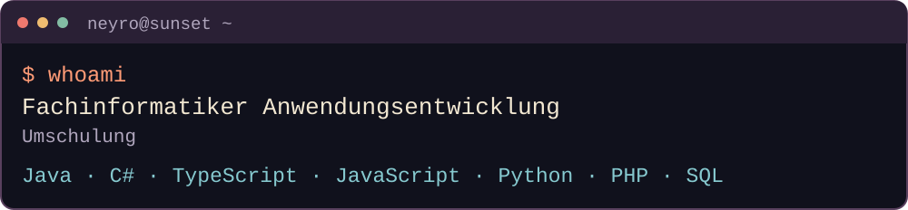
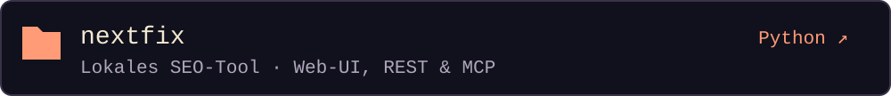
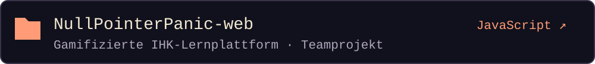
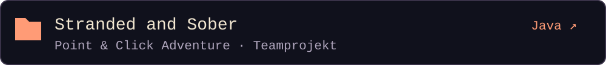
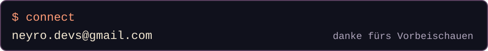

<picture>
  <source media="(max-width: 600px)" srcset="./assets/sunset-shell/about-mobile.svg">
  
</picture>

### `~/projekte/`

<a href="https://github.com/the-neyro/nextfix">
<picture>
  <source media="(max-width: 600px)" srcset="./assets/sunset-shell/nextfix-mobile.svg">
  
</picture></a>

<a href="https://github.com/stackcraft-op/NullPointerPanic-web">
<picture>
  <source media="(max-width: 600px)" srcset="./assets/sunset-shell/nullpointerpanic-mobile.svg">
  
</picture></a>

<a href="https://github.com/philipprcodes/PointAndClickAdventure">
<picture>
  <source media="(max-width: 600px)" srcset="./assets/sunset-shell/stranded-and-sober-mobile.svg">
  
</picture></a>

<a href="mailto:neyro.devs@gmail.com">
<picture>
  <source media="(max-width: 600px)" srcset="./assets/sunset-shell/connect-mobile.svg">
  
</picture></a>

Textversion & Links

**the-neyro** · Fachinformatiker Anwendungsentwicklung (Umschulung)

Java · C# · TypeScript · JavaScript · Python · PHP · SQL

- [Nextfix](https://github.com/the-neyro/nextfix) — Lokales SEO-Tool mit Web-UI, REST und MCP. **Python**.
- [NullPointerPanic-web](https://github.com/stackcraft-op/NullPointerPanic-web) — Frontend einer gamifizierten Lernplattform für die IHK-Prüfungen AP1 und AP2. **JavaScript · Teamprojekt**.
- [Stranded and Sober](https://github.com/philipprcodes/PointAndClickAdventure) — Point & Click Adventure mit Java und Swing. **Java · Teamprojekt**.

[neyro.devs@gmail.com](mailto:neyro.devs@gmail.com) · [GitHub](https://github.com/the-neyro)

