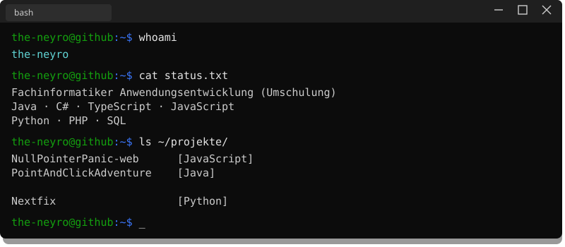
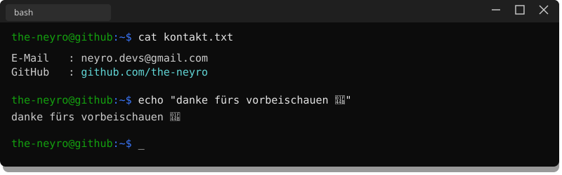

  

 

### Projekte

[NullPointerPanic](https://github.com/stackcraft-op/NullPointerPanic-web) — IHK-Lernplattform · React  
[Stranded & Sober](https://github.com/philipprcodes/PointAndClickAdventure) — Point-and-Click-Adventure · Java  
[Crypto Tracker](https://github.com/the-neyro/crypto-tracker) — Portfolio Tracker · TypeScript  
[Simple](https://github.com/the-neyro/projekt_php) — Web-App · PHP & MySQL

 

  

